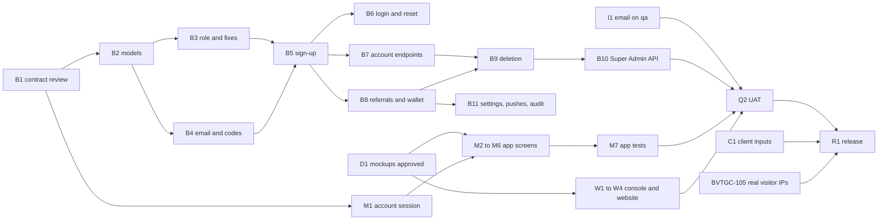

# Citizen wallet and referrals: technical implementation

| | |
|---|---|
| Status | **Approved for development**, 2026-11-25 (v6). Requirements are final ([requirements.md](requirements.md), decisions D1–D17). Nothing is built yet. |
| API | `docs/api-contract.md`, **section 21** (Planned). The contract is the source of truth for every path, field and error code; this document explains how to build it. |
| Jira | Epic BVTGC-106; the tickets are listed per team below and together in section 15. Later stage: epic BVTGC-118. |
| Code read for this design | BackEnd `dev` `2cc9d22`, Web `dev` `130e830`, Mobile `dev` `b3b7eff` |
| Owners | **Code:** Admin, with Claude, for every ticket. **Review and basic testing:** Basam Bhargavi (backend), Mohit (mobile and web). **UAT:** the testing team, Anvesh Kolli. Design drafts: Claude, approved by Admin. Email setup: Admin, with the server team. (Decided 2026-11-25; section 3.2.) |

Earlier versions: v5 (email and password, the client's plan), v4 (family phones, website deletion, pilot), v3 (login by code), v2 and v1 (Google sign-in). They are in the git history and attached to BVTGC-106.

## 1. About this document

Each team has its own section (5 to 13). Every subsection there is one Jira ticket, with:
- **What:** the scope;
- **Where:** the files and folders to touch;
- **How:** the design, where it is not obvious;
- **Done when:** the checks that close the ticket.

The project rules apply to every ticket (`.claude/project.md`, and each repo's `.claude/conventions.md`). Above all:
- every permission is checked on the server;
- portable ORM only, with tests on SQLite;
- audit only through `record()`;
- every user-facing text in Telugu and English;
- no full email, mobile number, password, code or token in a URL, log, audit entry or task argument.

## 2. Overview

```mermaid
sequenceDiagram
    participant App as Mobile app
    participant API as Backend
    participant MAIL as Email service (SMTP)
    App->>API: POST /citizen/auth/signup/ {name, mobile, email, password, village_id, ...}
    API->>MAIL: a 6-digit code to the email
    API-->>App: {signup_token, expires_in, resend_after, email_hint}
    App->>API: POST /citizen/auth/signup/verify/ {signup_token, code}
    API-->>App: 201 JWT pair + account (Citizen role); a referral starts PENDING
    Note over App,API: Later: POST /citizen/auth/login/ {login: email or mobile, password}
    Note over App,API: Forgotten password: /password/forgot/ {login}, then /password/reset/ {login, code, new_password}
    Note over API: Hourly job: PENDING referrals past their hold date are CONFIRMED or REJECTED
```

Three things are new:
- a **citizen account**: a Django user with the new Citizen role and a password;
- **email codes** for sign-up, a forgotten password and deletion from the website;
- a **wallet** with **referrals**.

Unchanged: reading news, posting and service requests stay without login, and the posting token (`X-Citizen-Token`, contract section 15) stays as it is. WhatsApp and SMS codes are a later stage (section 14).

## 3. Plan: owners, order and timeline

### 3.1 Who does what

Admin writes the code for every ticket, with Claude, and every ticket is assigned to Admin until its code is ready. The area's developer then reviews it and does the basic testing; the testing team runs UAT (Admin's decision of 2026-11-25).

| Team | Code | Review and basic testing | Tickets | Days |
|---|---|---|---|---|
| Backend | Admin | Basam Bhargavi | BVTGC-119 to BVTGC-130 | 21 |
| Design | Claude drafts | Admin approves | BVTGC-131 | 2, plus review |
| Mobile | Admin | Mohit | BVTGC-132 to BVTGC-138 | 12 |
| Web (console and website) | Admin | Mohit | BVTGC-139 to BVTGC-142 | 7 |
| Infrastructure | Admin, with the server team | Admin | BVTGC-143 | 1, plus the email service's approval |
| Client | Admin | Admin | BVTGC-144 | During development |
| QA | Admin writes the test plan | Anvesh Kolli reviews it and runs UAT | BVTGC-145, BVTGC-146 | 5 |
| Release | Admin | Admin | BVTGC-147 | 0.5 |

### 3.2 How a ticket moves

1. **To Do → In Progress:** Admin starts the ticket; Claude writes the code.
2. **Code:**
   - one branch per ticket from `dev`, named `feat/BVTGC-<n>-<short-name>`, as the repos already do;
   - the unit tests the ticket lists are written in the same branch;
   - the whole test suite passes before hand-off (`python -m pytest -q -p no:logging` in the backend; `flutter test` in the app; `npm run build` and the web's checks).
3. **Pull request** into `dev`, **left unmerged**: the reviewer merges it.
4. **In Review:** the ticket is assigned to the area's developer (backend: Basam Bhargavi; mobile and web: Mohit), with the pull request link and a short note of what changed and how to try it.
5. **The developer** reviews, does the basic testing, merges, and moves the ticket to **QA / UAT**.
6. **The testing team** (Anvesh Kolli) tests on qa; the ticket goes to **Ready for Production**, then **Done** after the release.

Tickets without code (design, email setup, client inputs, release) skip the pull request. The contract test's merge order still applies: an app or web pull request is merged only after the backend pull request its calls need (section 5.1).

### 3.3 Order



### 3.4 Timeline

**To be re-planned.** Since 2026-11-25 Admin writes the code for every ticket, so the weeks depend on the pace of coding and of the reviews. The order of section 3.3 still holds. The table below was the plan when Bhargavi and Mohit were to write the code; it is kept only as a guide to which tickets can run side by side.

| Week | Backend | Mobile and web | Others |
|---|---|---|---|
| 1 | BVTGC-119 contract review, BVTGC-120 models, BVTGC-121 role and fixes, BVTGC-122 email and codes | BVTGC-132 account session; reads the contract | BVTGC-131 mockups drafted and approved; BVTGC-143 email service and DNS started; BVTGC-145 test plan |
| 2 | BVTGC-123 sign-up, BVTGC-124 login and reset, BVTGC-125 account endpoints | BVTGC-133 create account, BVTGC-134 log in and reset | BVTGC-144 client inputs collected |
| 3 | BVTGC-126 referrals and wallet, BVTGC-127 deletion | BVTGC-135 wallet and invite, BVTGC-136 profile | |
| 4 | BVTGC-128 Super Admin API, BVTGC-129 settings, pushes, audit | BVTGC-137 links, pushes, switch; BVTGC-138 app tests | BVTGC-143 done on qa |
| 5 | BVTGC-130 permission tests and documents; fixes from the app's integration on qa | BVTGC-139 and BVTGC-140 console | |
| 6 | Fixes | BVTGC-141 and BVTGC-142 website | BVTGC-146 UAT starts |
| 7 | Fixes | Fixes | BVTGC-146 UAT ends; BVTGC-147 release to the pilot mandals |

That plan came to about 7 weeks.

## 4. Data model (shared)

Built by BVTGC-120. Everyone reads it: it explains the fields the API returns.

### 4.1 `apps.citizens` (the account)

`apps.citizens` already owns citizen identity (phones, posting tokens). The account lives next to it.

**CitizenAccount**

| Field | Type | Notes |
|---|---|---|
| `user` | OneToOne `accounts.User`, primary key | The Django user. The password is the user's own (`set_password`, Argon2 as for officials), checked with the citizen rule (5.5). |
| `village_id` | PositiveInteger | Also the area of the Citizen role assignment. |
| `age_confirmed_at` | DateTime | 18+ confirmation (D5). |
| `consent_version`, `consent_at` | Char(20), DateTime | Which consent notice was agreed, and when. |
| `email` | Email(254) | The address codes and notices go to, stored in lower case. Not `User.email`: officials' emails are contact only and not unique, and an official's own citizen account may use the same one. |
| `email_key` | Char(254), unique, null | The address's canonical form, one of the two login names. It is lower case; for `gmail.com` and `googlemail.com`, dots and anything after a `+` are removed before the @ and the domain becomes `gmail.com`. Null only after deletion. |
| `email_verified_at` | DateTime, null | Set by the sign-up code, a new email's code, or the first reset code after the Super Admin set the email (5.10). |
| `mobile_hash` | Char(64), unique, null | Keyed hash of the 10-digit number, the other login name (the same keyed hash as citizen phones, `citizens.services._keyed_hash`, keyed by `PHONE_HASH_KEY` since BVTGC-111). The full number is never stored. Null after deletion, or after the Super Admin removes it (D16). Not `User.mobile`: that column is unique across officials (`apps/accounts/models.py`), so an official's number would clash. |
| `mobile_last4` | Char(4) | For display and for the Super Admin's search. |
| `mobile_verified_at` | DateTime, null | Null until the later stage confirms the number (section 14). A number change clears it. |
| `last_active_at` | DateTime | The last day the app opened with the account (5.7), shown in the Super Admin's list. |
| `referral_code` | Char(8), unique | Generated, no look-alike characters (the alphabet of `apps/accounts/credentials.py`). |
| `signup_android_id_hash` | Char(64), indexed | From the phone used at sign-up. Limits the welcome bonuses per phone and skips the referrer's reward when both accounts signed up on the same phone (D10). |
| `deleted_at` | DateTime, null | Set when the account is deleted (5.9). |
| `deleted_mobile_hash`, `deleted_email_key` | Char(64), Char(254), indexed | Kept after deletion to stop repeat welcome bonuses (requirements Q9; 1 year by default). |
| `created_at` | DateTime | |

**PendingSignup**: one row per sign-up waiting for its email code. It is an unfinished form, not a record.

| Field | Notes |
|---|---|
| `id` | UUID |
| `name`, `village_id`, `language` | From the form |
| `mobile_hash`, `mobile_last4` | The number typed |
| `email`, `email_key` | The address typed |
| `password` | The password's hash (`make_password`); the password itself is never stored |
| `age_confirmed_at`, `consent_version` | |
| `referral_code` | As typed; checked again when the account is created |
| `android_id_hash` | May be empty |
| `created_at`, `expires_at` | Expires after 24 hours; housekeeping deletes expired rows (5.9) |

**VerificationCode**: one row per code sent. It never holds the code itself.

| Field | Notes |
|---|---|
| `purpose` | `SIGNUP`, `RESET_PASSWORD`, `CHANGE_EMAIL` or `DELETE`. The later stage adds `VERIFY_MOBILE`. |
| `channel` | `EMAIL`. The later stage adds `WHATSAPP` and `SMS`. |
| `pending_signup` | FK PendingSignup, null; set for `SIGNUP` |
| `account` | FK CitizenAccount, null; set for the other purposes |
| `email_key` | Where the code went, for the limits per address |
| `new_email`, `new_email_key` | `CHANGE_EMAIL` only: the address being proven. Cleared once used or expired. |
| `android_id_hash` | The phone that asked, for the per-phone limit; may be empty |
| `code_hash` | HMAC of the code with the row id and `SECRET_KEY` |
| `expires_at` | Sent + 10 minutes |
| `attempts` | Wrong tries, at most 5 |
| `verified_at`, `consumed_at` | Each code is used once |
| `provider_message_id` | The email service's message id, for support |
| `created_at` | Counts the limits |

**CitizenActiveDay**: `account`, `day` (DateField, India date), unique together. One row per day the app opened with the account. Rows older than 60 days are deleted by housekeeping; they are a counter, not records.

### 4.2 New app `apps.wallet`

Created as `.claude/conventions.md` says (`startapp wallet apps/wallet`, `name = "apps.wallet"`, label `wallet`, added to `LOCAL_APPS`).

**Wallet**: `account` (OneToOne CitizenAccount, PK), `confirmed_points` and `held_points` (PositiveInteger), `updated_at`. The two numbers are a cache of the entries, kept in step in the same transaction (5.8).

**WalletEntry** (append-only)

| Field | Notes |
|---|---|
| `id` | UUID |
| `wallet` | FK Wallet |
| `points` | Integer, never 0 (CheckConstraint); negative only for adjustments |
| `kind` | `REFERRAL_REWARD`, `WELCOME_BONUS`, `ADJUSTMENT` |
| `status` | `HELD`, `CONFIRMED`, `CANCELLED` |
| `referral` | FK Referral, null |
| `reason_key`, `reason` | The contract's reason keys; `reason` holds an adjustment's or a rejection's text |
| `created_by` | FK User, null (the Super Admin for adjustments) |
| `idempotency_key` | Char(64); unique together with `wallet`, the database guard against double rewards |
| `created_at`, `decided_at` | |

**Referral**

| Field | Notes |
|---|---|
| `id` | UUID |
| `referrer` | FK CitizenAccount |
| `referee` | OneToOne CitizenAccount: a citizen is referred at most once |
| `status` | `PENDING` (held), `CONFIRMED`, `REJECTED` |
| `reason_key`, `comment` | Why it was rejected; the Super Admin's comment |
| `pending_at`, `confirm_after`, `decided_at` | |
| `decided_by` | FK User, null (Super Admin) |
| `created_at` | |

Indexes: `(status, confirm_after)` for the job; `(referrer, status, decided_at)` for the monthly limit.

## 5. Backend (BVTGramaConnect_BackEnd)

Code: Admin. Review and basic testing: Basam Bhargavi. Area: Backend. One pull request per ticket into `dev`, left for the reviewer to merge (section 3.2), each with its tests and, where it changes the API, the contract's status mark (Planned → live).

### 5.1 Contract review and announcement (BVTGC-119, 0.5 day)

- **What:** section 21 of `docs/api-contract.md` is written (Planned). Read it with Mohit, settle anything unclear, and announce it to the app and web as the API to build against. Changes later follow the usual rule: contract first, then tell both.
- **Merge order (contract test, BVTGC-97):** `grama/tests/test_client_calls.py` fails CI when the app or the website calls an address this server does not answer. So the app and the web build their wallet screens on branches against the fake server, and merge them into `dev` only after the backend ticket with those endpoints is merged; then the list is refreshed with `python manage.py client_calls`.
- **Done when:** Mohit has confirmed the section and the merge order; any change is merged; the epic has a comment saying the contract is agreed.

### 5.2 Models and migrations (BVTGC-120, 1.5 days)

- **What:** the models of section 4, with constraints and indexes, and the new app `apps.wallet`.
- **Where:** `apps/citizens/models.py`, new `apps/wallet/` (models, `apps.py`, migrations), `grama/settings.py` (`LOCAL_APPS`).
- **How:**
  - schema migrations only; no data step is needed;
  - `email_key` and `mobile_hash` are unique and nullable, so deleted accounts free them;
  - the `points != 0` CheckConstraint and `(wallet, idempotency_key)` uniqueness are the database guards.
- **Done when:** `makemigrations --check --dry-run` is clean; the migrations run on SQLite in tests.

### 5.3 Citizen role, permissions and the officials-only fixes (BVTGC-121, 1.5 days)

- **What:** the Citizen group and new permissions, and the places that treat "has a role" as "is an official".
- **Where:** `apps/accounts/role_matrix.py`, the models' `Meta.permissions`, `apps/accounts/credentials.py`, `apps/accounts/views_auth.py`, `apps/web_admin/api.py`, `apps/posts/services.py`, `apps/accounts/serializers.py`, `docs/authorization.md`.
- **How:** add the group to `ROLE_GROUPS`:

```python
"CITIZEN": {
    "name": "Citizen",
    "name_te": "పౌరుడు",
    "level": "VILLAGE",
    "rank": 5,
    "platform_wide": False,
    "manage_permission": None,     # nobody gives it through users/; sign-up gives it
    "password_min_length": 0,      # the citizen rule is separate (5.5), never credentials.check_new_password
    "permissions": ["wallet.use_wallet"],
},
```

The key matches the existing `CITIZEN_ROLE = "CITIZEN"` used for device posts (`apps/posts/models.py`), so audit and post history read the same.

| Permission | Held by |
|---|---|
| `wallet.use_wallet` | Citizen |
| `wallet.view_wallets`, `wallet.adjust_points`, `wallet.review_referrals` | Super Admin (added to `PLATFORM_ADMIN`). The wallet settings use the existing `posts.manage_settings` (contract section 21), so there is no separate settings permission. |
| `accounts.manage_citizen_accounts` | Super Admin |
| `accounts.use_official_api` | Every official group |

Places that must change, because a citizen account now has a role and a password:

| Where | Problem | Change |
|---|---|---|
| `credentials.authenticate_official` (`auth/login/`, `auth/session/login/`) | A citizen could log in through the officials' login with the generated username | Refuse a user without `accounts.use_official_api` with the same `400 invalid_credentials` |
| `views_auth.PasswordChangeView` | It would apply the officials' rule to a citizen | Refuse citizen accounts with `403 permission_denied` |
| `web_admin/api.py` `HasAnyRole` (Telugu name suggestions) | A citizen could call Google through `admin/transliterate/` | `HasPerm("accounts.use_official_api")` |
| `posts/services.py` `covering_scope_q` | `GET /posts/` would list a village's posts to a citizen | Count only grants holding `accounts.use_official_api` |
| Dashboard and reports (`web_admin/api.py`) | Counts such as blocked users would include citizens | Officials only |
| `users/{id}/unlock/` and lockout lists | Citizen lockouts would show among officials' | Officials only |
| `apps/notifications/views.py` inbox (`GET /notifications/`, read, read-all; `IsAuthenticated`) | A citizen JWT passes `IsAuthenticated` | Officials only (`403`); wallet pushes keep no inbox entry |
| `apps/accounts/views_auth.py` `MeView` (`GET /me/`) | A citizen would get an official's empty profile | `403`; the app uses `GET /citizen/account/` |

Citizens stay out of the officials' user lists without extra code: `authz.manageable_users` keeps only users whose every assignment the actor may manage, and a group with `manage_permission: None` is managed by nobody.

- **Done when:** grep for `IsAuthenticated]` and `authz.grants(` confirms every place; each officials' endpoint answers a citizen account `403` (one test each, in BVTGC-130); `docs/authorization.md` lists the group and permissions.

### 5.4 Email sending and codes (BVTGC-122, 1.5 days)

- **What:** sending email for the first time in this backend, the email texts, and the code rules shared by every purpose.
- **Where:**
  - new `apps/citizens/emails.py` and `apps/citizens/codes.py`;
  - templates in `apps/citizens/templates/citizens/email/`;
  - `grama/settings.py` (section 6);
  - `deploy/setup.sh` and `deploy/config.env.example`, which today say "nothing is emailed";
  - `.env.example`.
- **How (sending):**
  - Django's `EmailMultiAlternatives` through `EMAIL_BACKEND`, the SMTP endpoint of the client's service (BVTGC-143). Settings: `EMAIL_HOST`, `EMAIL_PORT`, `EMAIL_HOST_USER`, `EMAIL_HOST_PASSWORD` (secret), `EMAIL_USE_TLS`, `EMAIL_TIMEOUT` (10 seconds), `DEFAULT_FROM_EMAIL`. Tests already use the locmem backend; laptops use the console backend.
  - Sent **in the request**, never in a django-q job: full emails must not be in task arguments, and the code exists only in memory. A failure answers `503 email_unavailable`, and nothing else in the app depends on email.
- **How (texts):**
  - one template per purpose and language (`te`, `en`), plain text plus a simple HTML copy, UTF-8;
  - the subject carries the code, for example "Grama Connect code: 482913", so it shows in the phone's notification;
  - the body says the code is valid for 10 minutes and must not be shared;
  - notices without a code: password changed, email changed (to the old address), account deleted. Final wording follows the approved mockups (BVTGC-131).
- **How (codes):**
  - 6 digits from `secrets.randbelow`; `code_hash` is an HMAC with the row id and `SECRET_KEY`;
  - valid 10 minutes, 5 wrong tries through a conditional UPDATE (`attempts < 5`), so parallel tries cannot exceed it;
  - a new code after 60 seconds (`429 code_cooldown` with `retry_after_s`);
  - at most 5 a day per account or `email_key`, and 10 a day per `android_id_hash` (`429 code_limit`);
  - per-IP limits only once BVTGC-105 brings back real visitor addresses (contract section 13).
- **Audit:** `citizen.code_sent` (purpose, channel, masked email through `apps/audit/masking.py` `mask_email`).
- **Done when:** a code email arrives in the locmem outbox in both languages; the limits and the cooldown have tests; no code or full address reaches logs, audit or task arguments (a test greps them).

### 5.5 Sign-up with the email code (BVTGC-123, 2 days)

- **What:** `POST /citizen/auth/signup/`, `/signup/resend/`, `/signup/verify/` (contract section 21), and the citizen password rule.
- **Where:** `apps/citizens/views_account.py` (new), `apps/citizens/services_account.py` (new, the only writer of accounts), `apps/citizens/passwords.py` (new), `apps/citizens/urls.py`, `grama/settings.py`.
- **How (the password rule, D15):**
  - a separate list, `CITIZEN_PASSWORD_VALIDATORS`: `MinimumLengthValidator` (`CITIZEN_PASSWORD_MIN_LENGTH`, 8), `CommonPasswordValidator`, `UserAttributeSimilarityValidator` on the name and the email, and a small validator refusing the mobile number itself;
  - checked with `validate_password(password, user, password_validators=get_password_validators(settings.CITIZEN_PASSWORD_VALIDATORS))`, never `credentials.check_new_password`;
  - the global `AUTH_PASSWORD_VALIDATORS` stay as they are; a test proves an official still needs 12 characters with the composition rule.
- **How (sign-up):**
  - checks in the contract's order: wallet switch, pilot (`403 wallet_not_in_area`), age, consent version, village, name, number (`mobile_validator`), email, password, referral code;
  - a number or email that belongs to an account answers `409 mobile_in_use` or `email_in_use`; accepted, as in most sign-up forms (R13);
  - creates a PendingSignup and a `SIGNUP` code, sends it (5.4), and answers with `signup_token` (`django.core.signing`, its own salt, carrying only the PendingSignup id), `expires_in`, `resend_after` and `email_hint`.
- **How (verify):** in one transaction:
  1. check that the number and the email are still free (the unique constraints are the real guard: `409`);
  2. create the user with a generated username that passes `username_validator` (never shown or used), the name, `preferred_language` and the pending password hash;
  3. create the Citizen assignment (`assigned_by` null, audited);
  4. create the account (`email_verified_at` now), its referral code and the wallet;
  5. create the referral, if a code was given (5.8);
  6. delete the PendingSignup and consume the code.
- **Answers:** `201 {access, refresh, account}` through `accounts.tokens.issue_tokens(user)`. Audit `citizen.account_created`.
- **Done when:** tests cover right, wrong and expired codes, resend, 24-hour expiry, 409s, Gmail variants, two sign-ups racing for one number or email, the token working once, the pilot, and the password rule (8 characters and numbers only accepted; common and own-number refused).

### 5.6 Login, lockout and a forgotten password (BVTGC-124, 1.5 days)

- **What:** `POST /citizen/auth/login/`, `/password/forgot/`, `/password/reset/`.
- **Where:** `apps/citizens/views_account.py`, `services_account.py`, `apps/accounts/lockout.py` (only if a helper is needed).
- **How (login):**
  - a `login` with an @ is matched on `email_key`; 10 digits on `mobile_hash`; anything else is `400 invalid_credentials`;
  - then `authenticate(request, username=<the account's generated username>, password=…)`, so django-axes counts the email and the number as one account: 5 failures per account and IP give `429 locked_out` with `retry_after_s`. The ceiling per username of BVTGC-110 (20 failures within an hour from any addresses) applies too;
  - an unknown login is counted under the typed value's key, and the hasher still runs once, so the answer takes the same time;
  - wrong password, unknown login and deleted account: `400 invalid_credentials`. Blocked: `403 account_blocked`;
  - success: `{access, refresh, account}`; audit `auth.login` with `via="citizen"` (the audit's `via` holds at most 10 characters).
- **How (forgotten password):**
  - `forgot` creates a `RESET_PASSWORD` code only for an active account, and always answers the same;
  - `reset` checks the newest live code of that account (`400 code_expired` for an unknown login, like an expired code). The right code, in one transaction:
    - checks the new password with the citizen rule and sets it;
    - sets `email_verified_at` if empty;
    - calls `revoke_all_sessions(user)`, which also unlinks push devices since BVTGC-94; the app links its phone again after the reset;
    - calls `lockout.unlock(user)`;
    - consumes the code;
    - audits `citizen.password_reset`.
  - Then it sends the notice and answers with tokens.
- **Done when:** tests cover login by email and by mobile; the shared lock; the same answer for unknown logins; blocked and deleted accounts; the 90-day limit; reset ending other sessions and the lock; and the notice email.

### 5.7 The citizen's own account (BVTGC-125, 1.5 days)

- **What:** `GET`/`PATCH /citizen/account/`, `POST /citizen/account/password/`, `/email/`, `/email/verify/`, `/mobile/`.
- **How:**
  - **`GET /citizen/account/`** inserts today's CitizenActiveDay (`get_or_create` on the unique pair) and sets `last_active_at`: one cheap write per account per day.
  - **`PATCH /citizen/account/`** with a new `village_id` moves the role assignment's area; audit `citizen.village_changed`.
  - **Wrong passwords** on password, email or mobile changes count with `credentials.confirm_own_password` (`PASSWORD_CHANGE_MAX_FAILURES`), as for officials.
  - **Password change:** other sessions end and this phone gets new tokens; a notice email; audit `citizen.password_changed`.
  - **Email change:** a `CHANGE_EMAIL` code to the new address. Verify sets `email`, `email_key` and `email_verified_at` in one UPDATE (`409` on a race), then sends a notice to the old address. Audit `citizen.email_changed` (masked).
  - **Mobile change:** sets `mobile_hash` and `mobile_last4` and clears `mobile_verified_at` in one UPDATE, or answers `409 mobile_in_use`. Audit with the old and new last 4 digits.
- **Done when:** each change has tests, wrong passwords included; the active-day row is written once a day.

### 5.8 Referrals and the wallet (BVTGC-126, 3 days)

- **What:** referrals at sign-up, held entries, the hourly confirmation job, the daily consistency check, `GET /wallet/`.
- **Where:** `apps/wallet/services.py` (the only writer of entries and referrals), `apps/wallet/tasks.py`, `apps/wallet/views.py`, `apps/posts/management/commands/ensure_schedules.py` (register the two schedules).
- **How (at sign-up):**
  - The referral code is checked at `signup/` and again at `signup/verify/`. It is refused with `referral_code_invalid`, `referral_code_own` (same `mobile_hash` or `email_key`) or `referral_not_open` (blocked or deleted referrer).
  - Inside the verify transaction, a Referral is created as `PENDING` with `confirm_after = now + REFERRAL_HOLD_DAYS`.
  - Up to two HELD entries follow, with idempotency keys `ref:<id>:referrer` and `ref:<id>:welcome`:
    - **the referrer's reward,** unless both accounts signed up on one phone (`same_phone`);
    - **the welcome bonus,** unless the phone already had `WELCOME_BONUSES_PER_PHONE` bonuses (deleted accounts included), or a deleted account with the same number or `email_key` had one (`welcome_limit`), or no `android_id` was sent (`no_device`).
  - `held_points` rises through `F()` updates. After commit, the referrer gets a push.
- **How (the hourly job, `decide_referrals`):** for each `PENDING` referral past `confirm_after`, in this order:

| Reason | When |
|---|---|
| `blocked` | Either account is blocked |
| `deleted` | Either account is deleted |
| `not_active` | The referee had fewer than `REFERRAL_ACTIVE_DAYS` active days between `pending_at` and `confirm_after` |
| `monthly_limit` | The referrer already has `REFERRALS_PER_MONTH` confirmed referrals this calendar month (India time) |

  - Otherwise the referral is `CONFIRMED`.
  - Each move is a conditional UPDATE (`status='PENDING'`), so two workers cannot both decide.
  - In the same transaction the entries move HELD → CONFIRMED or CANCELLED, and the cache moves with them (`held_points = F(...) - n`, `confirmed_points = F(...) + n`).
  - Pushes go after commit. Audit `referral.confirmed` or `referral.rejected`.
- **How (consistency):** a daily job compares each wallet's cache with the sum of its entries and audits `wallet.mismatch` on a difference. The entries are the truth.
- **Done when:** tests cover:
  - each reason;
  - self-referral by mobile and by email;
  - the same-phone rule;
  - the per-phone and deleted-account welcome limits;
  - no `android_id`;
  - the monthly limit;
  - two parallel confirmations (one wins);
  - the idempotency key;
  - the cache always equals the sum of entries.

### 5.9 Account deletion and housekeeping (BVTGC-127, 1.5 days)

- **What:** `POST /citizen/account/delete/`, `/citizen/auth/delete/code/`, `/citizen/auth/delete/`, and the Super Admin's delete (route in BVTGC-128), all through one service function; new housekeeping steps.
- **How (deletion):** in one transaction:
  - `is_active` false and `revoke_all_sessions`;
  - name "Deleted citizen", username scrambled, password unusable;
  - `email` cleared, and `email_key` moved to `deleted_email_key`;
  - `mobile_hash` moved to `deleted_mobile_hash`;
  - push devices unlinked;
  - the role assignment deactivated;
  - HELD entries cancelled.

  Confirmed entries and referrals stay, without personal details (owner's decision of 2026-11-25, Q8). The "account deleted" notice goes before the address is cleared. Audit `citizen.account_deleted` with `via` (`app`, `website`, `admin`). The website's code is a `DELETE` code; a `RESET_PASSWORD` code must not work there.
- **How (housekeeping, `grama/housekeeping.py`):** delete expired PendingSignups and VerificationCodes older than 7 days, CitizenActiveDay rows older than 60 days, and clear `deleted_*` fingerprints after `CITIZEN_DELETED_KEEP_DAYS` (365, requirements Q9).
- **Done when:** tests cover personal fields cleared and entries kept; no second welcome bonus on re-sign-up; the website's deletion needing its own code; and the housekeeping steps.

### 5.10 Super Admin API (BVTGC-128, 2.5 days)

- **What:** `admin/citizen-accounts/` (list, find, email, release-mobile, block, unblock, delete), `admin/referrals/` (list, confirm, reject), `admin/wallets/{id}/adjust/`, `admin/wallet/export/` (contract section 21).
- **Where:** `apps/citizens/views_admin.py` (it already serves `admin/citizens/` for blocked phones; keep the new routes under `admin/citizen-accounts/`), `apps/wallet/views_admin.py`.
- **How:**
  - **Find** is a POST, so a number or email never goes in a URL; it is audited.
  - **Set email** needs `called_back: true`. It sets the new address unconfirmed and makes codes to the old address stop working; audit `citizen.email_set_by_admin`.
  - **Release mobile** needs `called_back: true`. It clears the number on that account, whose next `GET /citizen/account/` says `mobile_missing: true`; audit `citizen.mobile_released`.
  - **Block and unblock** use `accounts.tokens.block_user` and `unblock_user`.
  - **Adjust** writes an ADJUSTMENT entry. A negative one uses `UPDATE … WHERE confirmed_points >= n`, else `409 not_enough_points`.
  - **Confirm and reject** are conditional on `PENDING` (`409 already_decided`).
  - **CSV** files start with a UTF-8 BOM and carry the last 4 digits and masked emails only. Rows carry `allowed_actions`.
- **Done when:** every endpoint has its permission test (Super Admin yes, every other group and a citizen no); the call-back rule; and every action audited.

### 5.11 Settings, app-config, pushes, audit labels and Telugu (BVTGC-129, 2 days)

- **What:**
  - **Runtime settings** (`apps/posts/services.py` `RUNTIME_SETTINGS`, with env defaults in `grama/settings.py`): `WALLET_ENABLED` (False), `WALLET_PILOT_MANDALS` (empty), `REFERRAL_REWARD_POINTS` (50), `WELCOME_BONUS_POINTS` (20), `REFERRAL_HOLD_DAYS` (7), `REFERRAL_ACTIVE_DAYS` (2), `REFERRALS_PER_MONTH` (30), `WELCOME_BONUSES_PER_PHONE` (3), with the contract's ranges.
  - **Env only:** `CITIZEN_CONSENT_VERSION`, `CITIZEN_PASSWORD_MIN_LENGTH`, `CITIZEN_DELETED_KEEP_DAYS`, and the email settings (BVTGC-122).
  - **`GET /app-config/`** adds `wallet_enabled`, `wallet_pilot_mandals` and `wallet_consent_version`.
  - **Feature switch:** every section 21 endpoint answers `404` while the wallet is off.
  - **Pushes:**
    - `NotificationKind.WALLET`;
    - templates `referral_joined`, `points_confirmed` and `points_not_confirmed` in Telugu and English, added by a data migration and editable in the console;
    - sent through `send_push_to_users`, with only ids in the data; push only, no inbox entry (contract review, BVTGC-119).
  - **Audit labels:** the keys of contract section 21, added to the console's and the app's label lists (tell Mohit).
  - **Telugu:** run `python manage.py translations` and write the Telugu of every new message.
- **Done when:** the settings validate their ranges and are audited; `test_i18n.py` passes; the switch hides every endpoint.

### 5.12 Permission and security tests, documents (BVTGC-130, 2 days)

- **What:**
  - extend `apps/accounts/tests/test_matrix.py` with the Citizen group;
  - one test per officials' endpoint answering a citizen JWT `403`;
  - a test that no new code path logs or audits a full email, number, password or code;
  - each new test file in `grama/tests/suite.json`;
  - update `docs/security-review.md` (new personal data, the SMTP secret, the shorter citizen password rule and its mitigations, fraud controls) and `docs/authorization.md`;
  - mark section 21 **live**, endpoint by endpoint, as code merges.
- **Done when:** `python -m pytest -q -p no:logging` and `python -m grama.testsuite all` are green.

## 6. Mobile app (BVTGramaConnect_Mobile)

Code: Admin. Review and basic testing: Mohit. Area: Mobile. One pull request per ticket, left for the reviewer to merge (section 3.2). Build against contract section 21 and the approved mockups (BVTGC-131). Test against the local fake server first (as `test/app_flow_test.dart`), then against qa when the backend is there. Merge into `dev` only after the backend endpoints a screen calls are merged (the contract test of BVTGC-97, section 5.1).

### 6.1 Where things live

| Part | Place |
|---|---|
| API calls | `lib/features/grama/data/api_client.dart` (token storage, refresh and `session_revoked` already work there; reuse them) |
| Screens | new `lib/features/grama/presentation/screens/wallet_screens.dart` and `citizen_account_screens.dart`; entries in `citizen_home.dart`, `shell.dart` and the citizen Profile in `account_screens.dart` |
| Texts | `lib/core/i18n` (Telugu and English) |
| Widgets, colours | `lib/core/widgets`, `lib/core/theme` (no new style; follow the mockups) |
| App Links | `android/app/src/main/AndroidManifest.xml` |

### 6.2 Citizen account session (BVTGC-132, 1 day)

- **What:**
  - one account at a time, an official's or a citizen's;
  - a citizen account state (signed out, signed in, `mobile_missing`) next to the existing citizen mode;
  - the API methods of section 21;
  - Android Phone Number Hint for the mobile field;
  - autofill hints.
- **How:**
  - add one package for Phone Number Hint, such as `smart_auth`, pinned in `pubspec.yaml`; check its current version first. It needs Google Play services but no permission and no Google account.
  - Forms sit in an `AutofillGroup` with `autofillHints`: `email`, `telephoneNumber`, `newPassword` and `password`, `oneTimeCode`. Android's autofill can then offer the phone's Google account email and save the password.
  - The citizen JWT is stored and refreshed exactly like an official's.
- **Done when:** a fake-server test signs in, refreshes and signs out a citizen account, and an official's login still works as before.

### 6.3 Create account and the email code (BVTGC-133, 2 days)

- **What:**
  - **Sign in to earn points**, with **Log in** and **Create account**;
  - the **Create account** form;
  - **Check your email**.
- **How:**
  - The form has the name, the mobile number (offered from the SIMs), the email, the password and confirm password (with show and hide), **I am 18 or older**, the consent notice with links to the privacy policy and terms, and the referral code (pre-filled from an invite link).
  - The app checks that the two passwords match, and shows the 8-character rule under the field.
  - Server errors go on their fields (`fields`). `mobile_in_use` and `email_in_use` offer **Log in** and **Forgot password?**. `wallet_not_in_area` and the referral errors show on the form.
  - **Check your email** shows `email_hint`, the code field, the 60-second resend timer, "Check your spam folder", and **Change email** (back to the form, which keeps its values).
  - `code_wrong` shows the tries left; `code_expired` offers **Send again**; `signup_token_invalid` starts over.
  - `consent_version` comes from `app-config`.
- **Done when:** fake-server tests pass for a sign-up with a wrong code then the right one, and for a `409`.

### 6.4 Log in and the forgotten password (BVTGC-134, 1.5 days)

- **What:** **Log in** (email or mobile number, password with show and hide, **Forgot password?**) and **Forgot password** (login, then the code and a new password twice).
- **How:**
  - `locked_out` shows the minutes left from `retry_after_s`; `account_blocked` says the account is blocked and gives the help line.
  - Forgot password shows "If this is registered, we sent a code to its email" whatever the answer.
  - After a reset, the app is signed in and links its phone again (`POST /devices/`).
- **Done when:** fake-server tests pass for login by email, login by mobile, a lockout message and a reset.

### 6.5 Wallet and invite (BVTGC-135, 2 days)

- **What:**
  - **Wallet:** the confirmed balance, the points on hold with the expected date, and the history (cursor list) with each status and the reason text;
  - "Points have no cash value";
  - **Questions about points?**, which opens the existing help-line numbers screen, where the Super Admin lists the support number (D11, C6);
  - **Invite friends:** the code, **Copy**, and **Share** (WhatsApp first, through the existing `share_plus`), with the `invite_url`.
- **Done when:** the wallet renders empty, held-only and long-history states from the fake server, in both languages.

### 6.6 Profile: account entries (BVTGC-136, 1.5 days)

- **What:** in the citizen Profile:
  - Wallet and Invite;
  - **Change password** (current password, new password twice);
  - **Change email** (the new email and the password, then the code screen of BVTGC-133);
  - **Change mobile number** (the new number and the password);
  - **Log out**;
  - **Delete my account** (the password and a confirmation that the points are lost).
- **How:** when `GET /citizen/account/` says `mobile_missing`, the app asks for a new number before anything else. `mobile_in_use` points to the help line.
- **Done when:** fake-server tests cover each change, and each one's main error.

### 6.7 Invite links, pushes and the feature switch (BVTGC-137, 2 days)

- **What:**
  - **Invite links:** add `android:pathPrefix="/app/"` next to the existing `/p/` App Link. The server's `/.well-known/assetlinks.json` already covers the domain. The app keeps `ref` until sign-up; installs from the website get the code from the link or by typing it.
  - **On open:** `GET /citizen/account/` (records the active day), and `POST /devices/` with the citizen JWT so pushes reach the account. Handle the `WALLET` push kind (open the wallet).
  - **Feature switch:** everything hides while `app-config` says `wallet_enabled: false`, and while the village chosen in the app is outside `wallet_pilot_mandals` (when the list is not empty). There, an invite link opens "The wallet is coming to your area soon". A signed-in account keeps its wallet wherever its village moves.
- **Done when:** a link with `ref` pre-fills the form; the wallet hides and shows with the switch and the pilot list.

### 6.8 App tests (BVTGC-138, 2 days)

- **What:** end-to-end flows against the fake server: sign-up, login by email and by mobile, forgotten password, each profile change, wallet and history, invite pre-fill, log out, delete; Telugu and English; a budget-phone screen size.
- **Done when:** the flows pass in CI or locally, and a build for qa goes on the website as usual.

## 7. Web: console and website (BVTGramaConnect)

Code: Admin. Review and basic testing: Mohit. Area: Web. One pull request per ticket, left for the reviewer to merge (section 3.2). The console is a port with "zero visual change", so new screens follow the approved mockups (BVTGC-131) and reuse existing styles (tables, tabs, panels, `ds.tsx`). Merge into `dev` only after the backend endpoints a page calls are merged (the contract test of BVTGC-97, section 5.1).

### 7.1 Console: Citizens & wallet, accounts and help (BVTGC-139, 2.5 days)

- **What:**
  - a new page, **Citizens & wallet**, in the sidebar for holders of the new permissions (`Console.tsx` `NAV_PERM`: `accounts.manage_citizen_accounts`, `wallet.review_referrals`, `wallet.view_wallets`);
  - an **Accounts** tab: search by name or last 4 digits, filters, and **Find by mobile or email** for a caller;
  - an account panel (next to the existing `panels/CitizenDetail.tsx`, which is about blocked phones, not accounts) with block, unblock, delete, **Set new email** and **Remove mobile number**;
  - each help action asks "Did you call the number back and speak to the citizen?" and a reason before the button works.
- **Where:** `src/console/screens/` (new `CitizensWallet.tsx`), `src/console/panels/` (new `CitizenAccountPanel.tsx`), `src/console/api.ts`, `src/console/types.ts`, `src/console/Console.tsx`, `src/console/layout/Sidebar.tsx`.
- **Done when:** the page matches the mockup; every action shows the server's errors; nothing shows a full email or number.

### 7.2 Console: referrals, adjustments, exports, settings (BVTGC-140, 2.5 days)

- **What:**
  - a **Referrals** tab with status tabs, reason, **Confirm** and **Reject** (comment required; `409 already_decided` refreshes the row);
  - **Adjust points** in the account panel (whole points, reason required, `409 not_enough_points`);
  - CSV export for referrals and entries;
  - the **Settings** page gains the eight wallet settings, with a mandal picker for the pilot that reuses the console's area picker;
  - the audit screen gains the new action labels (BVTGC-129).
- **Where:** `src/console/screens/CitizensWallet.tsx`, `Settings.tsx`, `Audit.tsx` labels, `api.ts`.
- **Done when:** the settings save and show the server's range errors; the exports open in Excel with Telugu names.

### 7.3 Website: the friend's code and the legal texts (BVTGC-141, 1 day)

- **What:**
  - `/app/?ref=<code>` already redirects to the download section and keeps the query;
  - the download section (`src/website/sections/home/Download.tsx`) reads `ref`: 8 characters from the code alphabet, anything else ignored;
  - it shows "Your friend's referral code: **CODE**" with **Copy**;
  - the privacy policy and terms (`legal` in `src/website/locales/te.json` and `en.json`, `sections/Legal.tsx`) gain the account, the data (the email included), the 18+ rule, "points have no cash value", and how to delete the account, using the client's texts (BVTGC-144, C5).
- **Done when:** the code shows only for a valid `ref`; the legal pages show the new texts in both languages.

### 7.4 Website: Delete my wallet account (BVTGC-142, 1 day)

- **What:** a new page with its own address, for example `/delete-account/`. It is added to `PAGES` and `SLUG` in `src/website/routes.ts`, so the static export makes its HTML file.
  - Step 1: the email or the mobile number, then **Send code**.
  - Step 2: the code, then **Delete my account** after a warning that the points are lost.
  - Step 3: a confirmation.
- **How:** it calls `POST /citizen/auth/delete/code/` and `POST /citizen/auth/delete/` on the same domain, so it needs no CORS. It always says "If this is registered, we sent a code to its email". The privacy policy links to it. Its address is the deletion URL for Google Play (BVTGC-147).
- **Done when:** the page works against qa in both languages and on a phone-sized screen.

## 8. Design (BVTGC-131)

Claude drafts the mockups; Admin and the owner approve them. They are **plain HTML files on the local disk**, in the BackEnd repo at `docs/features/citizen-wallet/mockups/`, and are committed once approved. They follow the approved prototype's look:
- colours and typography from `docs/prototype-inventory.md` (mobile design tokens);
- the prototype's components (`Grama Connect Mobile V2.dc.html` and `Super Admin Console.dc.html`, read-only, never copied).

| File | Screens |
|---|---|
| `mobile.html` | Sign in to earn points; Create account (with field errors); Check your email; Log in (with the lock message); Forgot password (two steps); Wallet (empty, held, history); Invite friends; Profile with the account entries; Change password, email and mobile; Delete my account; "Coming to your area soon"; the new-number prompt (`mobile_missing`) |
| `console.html` | Citizens & wallet: Accounts tab, account panel with block, delete, set email, remove number and adjust points; Referrals tab; the wallet part of Settings |
| `website.html` | Download section with a friend's code; Delete my wallet account (three steps) |
| `emails.html` | The code email and the three notices, in Telugu and English |

Every screen in Telugu (the default) and English, at a budget phone's width (360 px).

- **Done when:** Admin approves each file; changes are noted in the ticket; the files are committed.

## 9. Infrastructure: the server team (BVTGC-143)

Owner: Admin, who passes the work to the server team. Area: DevOps.

| Step | Who | Notes |
|---|---|---|
| Choose the email service and create the account, for example Amazon SES (Mumbai region) or Zoho ZeptoMail | Client and Admin (C7) | SES must be asked to leave its test mode first, usually within a day. Cost: SES about US$0.10 per 1,000 emails |
| Sender address on the client's domain, for example `no-reply@gramaconnect.com` | Client | Replies are not read; the emails say so and give the help line |
| DNS: SPF, DKIM and DMARC for the sender's domain | The client's domain admin with the server team | Without them Gmail may treat the codes as spam |
| Check that the servers can reach the SMTP port (587 with TLS) | Server team | Some hosts block outgoing mail ports; the hosting panel may need a change (BVTGC-39) |
| SMTP user and password | Server team | A secret: each server's `.env` only, never in git |
| `.env` on **qa first**, then production: `EMAIL_BACKEND` (SMTP), `EMAIL_HOST`, `EMAIL_PORT`, `EMAIL_HOST_USER`, `EMAIL_HOST_PASSWORD`, `EMAIL_USE_TLS`, `DEFAULT_FROM_EMAIL`, `CITIZEN_CONSENT_VERSION` | Server team | `WALLET_ENABLED` stays off; the Super Admin switches it on in the console |
| After the first wallet deploy: `python manage.py ensure_schedules` | Server team | Registers the hourly referral job and the daily wallet check (the deploy script runs it) |
| A daily sending cap and a bounce alert at the email service | Server team | Protects against bots and shows delivery problems |
| Backups | Server team | The new tables are in the same database; nothing extra |

- **Depends on:** BVTGC-105, which brings back real visitor addresses for the per-IP limits before go-live, and BVTGC-39, the production hosting details.
- **Done when:** a test code from qa reaches a Gmail inbox, not spam, in Telugu; the same on production before the release.

## 10. Client (BVTGC-144)

Owner: Admin. Decided during development (lead's decision of 2026-11-25); until then the suggestion in the requirements (section 12) is the default, and each item is a setting or a text that changes without new code.

| Item | Default until answered | Needed by |
|---|---|---|
| Q1 / C4: the name of the points, in Telugu and English | "Grama points" / "గ్రామ పాయింట్లు" | BVTGC-131 uses the default; final texts before BVTGC-146 |
| Q2 / C4: reward and welcome amounts | 50 and 20 | Release (BVTGC-147); a setting |
| Q3: welcome bonus held until the friend is active | Yes | Built that way |
| Q4: points expire? | No | Built that way |
| Q7: wallets for officials | No | Built that way |
| Q9: keep deleted accounts' fingerprints for 1 year (legal) | 1 year | Release; `CITIZEN_DELETED_KEEP_DAYS` |
| Q11: pilot mandals and how long | 2 or 3 mandals, about a month | Release; a setting |
| C5: privacy policy and terms with legal review | Draft texts from BVTGC-141 | BVTGC-141, before release |
| C6: the support number and who answers it | — | Release: the Super Admin adds it as a statewide help line |
| C7: email sending | — | BVTGC-143, before BVTGC-146 |

The later stage's inputs (C1 to C3) are in section 14.

## 11. QA (BVTGC-145, BVTGC-146)

Test plan: Admin writes it (BVTGC-145) and Anvesh Kolli reviews it. UAT: the testing team, Anvesh Kolli, runs it (BVTGC-146), assigned to them when the code is ready. Area: QA.

**BVTGC-145 Test plan and UAT checklist (1.5 days).** A wallet section in `docs/uat.md`, role by role:
- a citizen without an account (nothing changes);
- a new citizen (sign-up in Telugu, wrong code, resend, spam folder);
- a returning citizen (login by email and by mobile, lockout, forgotten password);
- profile changes;
- referrals: two phones, one referral confirmed after the hold, one rejected for inactivity (shorten `referral_hold_days` on qa);
- family phones: a 4th account gets no welcome bonus;
- deletion in the app and on the website;
- the Super Admin: search, find, call-back help, block, adjust, settings, CSV;
- officials: they see no citizens, and their login refuses a citizen.

**BVTGC-146 UAT on qa (3.5 days).**
- **Devices:** at least two budget Android phones, one with two SIMs.
- **Email:** real inboxes, at least two Gmail and one other provider, with the codes checked for spam placement.
- **Telugu:** every screen and email.
- **Switch and pilot:** the wallet off, then on for one mandal.
- **Done when:** the checklist passes, or each failure has a ticket the lead accepts for later.

## 12. Documents and project rules

Done now (2026-11-25, with this version):
- `docs/api-contract.md`: section 21 (Planned), with the cross-references in sections 1, 5, 12 and 13.
- `.claude/project.md`: the roles table and three owner decisions (the wallet account; email codes and a required email for citizens; deletable citizen accounts), the same in all three repos.

With the code:
- `docs/authorization.md` (BVTGC-121);
- `docs/security-review.md` (BVTGC-130);
- `docs/uat.md` (BVTGC-145);
- section 21 marked live endpoint by endpoint;
- `.claude/api.md` ("Who calls what") and `docs/client-calls.json` (`python manage.py client_calls`) once the clients' wallet calls are merged.

## 13. Release (BVTGC-147)

Owner: Admin.
1. The backend is merged and deployed with `WALLET_ENABLED` off; nothing visible changes. The app build with the new screens is released through the website as usual; it hides the wallet while the switch is off.
2. Before switching on in production:
   - UAT has passed (BVTGC-146);
   - BVTGC-105 is deployed;
   - email works on production (BVTGC-143);
   - the amounts, legal texts and support number are in (BVTGC-144);
   - the support number is listed as a statewide help line.
3. Set the pilot mandals, then switch the wallet on in the console. Watch the referrals list, `wallet.mismatch` entries and email bounces daily during the pilot.
4. Widen the mandals after the pilot (Q11).
5. When the app goes on Google Play: give the website's deletion page as the account deletion URL, and add the Play Integrity check to sign-up (R1 in section 16).

## 14. Later stage: WhatsApp and SMS (epic BVTGC-118)

Must go live **before Bills & Recharges** (BVTGC-107, D17). For now there is one ticket, BVTGC-148 on Admin, for the client's registrations, which take weeks: a Meta Business account, a WhatsApp number and approved code template (C1, C2), and DLT registration with an SMS provider (C3). The development tickets come when the stage is planned. In outline, it reuses the v3 and v4 design (git history of this file):
- `WHATSAPP_GATEWAY` (Meta Cloud API, authentication template with the copy-code button) and `SMS_GATEWAY` (DLT template and sender name), each off without its secret. `app-config` lists the channels that are on.
- `VerificationCode` gains the channels `WHATSAPP` and `SMS` and the purpose `VERIFY_MOBILE`. Codes are sent in the request; the number is typed or confirmed each time and never stored.
- New endpoints confirm the number and set `mobile_verified_at`. When the stage goes live, the app asks every account without a confirmed number to confirm it once; after that, a number change needs a code to the new number.
- A forgotten password can also be reset by WhatsApp or SMS.
- Android's SMS User Consent API fills an SMS code in after one tap on **Allow** (no app hash, Telugu works).
- Bills & Recharges answer `403 mobile_not_verified` to an unconfirmed number.
- **Cost and effort:**
  - WhatsApp authentication messages are about ₹0.115 each, and SMS codes about ₹0.10 to ₹0.45 (third-party 2026 figures);
  - each citizen confirms once;
  - effort: backend about 5 days, mobile 3, web 0.5, QA 2.

## 15. Tickets

All under epic BVTGC-106 unless noted, labelled `citizen-wallet` and the team. Every ticket is assigned to Admin, who writes the code; the reviewer gets it at In Review (section 3.2).

| Ticket | Title | Reviewer | Days | Depends on |
|---|---|---|---|---|
| BVTGC-119 | Backend: review contract section 21 with the app and web, and announce it | Basam Bhargavi | 0.5 | — |
| BVTGC-120 | Backend: wallet models and migrations | Basam Bhargavi | 1.5 | BVTGC-119 |
| BVTGC-121 | Backend: Citizen role, permissions and the officials-only fixes | Basam Bhargavi | 1.5 | BVTGC-120 |
| BVTGC-122 | Backend: email sending, email texts and code rules | Basam Bhargavi | 1.5 | BVTGC-120 |
| BVTGC-123 | Backend: sign-up with the email code and the citizen password rule | Basam Bhargavi | 2 | BVTGC-121, BVTGC-122 |
| BVTGC-124 | Backend: citizen login, lockout and forgotten password | Basam Bhargavi | 1.5 | BVTGC-123 |
| BVTGC-125 | Backend: the citizen's own account and profile changes | Basam Bhargavi | 1.5 | BVTGC-123 |
| BVTGC-126 | Backend: referrals, wallet and the hourly job | Basam Bhargavi | 3 | BVTGC-123 |
| BVTGC-127 | Backend: account deletion and housekeeping | Basam Bhargavi | 1.5 | BVTGC-125, BVTGC-126 |
| BVTGC-128 | Backend: Super Admin API for accounts, help, referrals and points | Basam Bhargavi | 2.5 | BVTGC-126, BVTGC-127 |
| BVTGC-129 | Backend: wallet settings, app-config, pushes, audit labels, Telugu | Basam Bhargavi | 2 | BVTGC-126 |
| BVTGC-130 | Backend: permission and security tests, authorization and security documents | Basam Bhargavi | 2 | BVTGC-123 to BVTGC-129 |
| BVTGC-131 | Design: wallet mockups for the app, console, website and emails | Admin (Claude drafts) | 2 | — |
| BVTGC-132 | Mobile: citizen account session, Phone Number Hint, autofill | Mohit | 1 | BVTGC-119 |
| BVTGC-133 | Mobile: Create account and Check your email | Mohit | 2 | BVTGC-132, BVTGC-131 |
| BVTGC-134 | Mobile: Log in and Forgot password | Mohit | 1.5 | BVTGC-132, BVTGC-131 |
| BVTGC-135 | Mobile: Wallet and Invite friends | Mohit | 2 | BVTGC-132, BVTGC-131 |
| BVTGC-136 | Mobile: account entries in Profile and Delete my account | Mohit | 1.5 | BVTGC-133 |
| BVTGC-137 | Mobile: invite links, wallet pushes and the feature switch | Mohit | 2 | BVTGC-135 |
| BVTGC-138 | Mobile: wallet flow tests | Mohit | 2 | BVTGC-133 to BVTGC-137 |
| BVTGC-139 | Web console: Citizens & wallet page, accounts and help actions | Mohit | 2.5 | BVTGC-119, BVTGC-131 |
| BVTGC-140 | Web console: referrals, point adjustments, exports and wallet settings | Mohit | 2.5 | BVTGC-139 |
| BVTGC-141 | Website: friend's referral code and legal texts | Mohit | 1 | BVTGC-131 |
| BVTGC-142 | Website: Delete my wallet account page | Mohit | 1 | BVTGC-119, BVTGC-131 |
| BVTGC-143 | Infra: email sending for citizen codes (C7) on qa and production | Admin (server team) | 1 | — |
| BVTGC-144 | Client: inputs and decisions for the wallet launch | Admin | — | — |
| BVTGC-145 | QA: wallet test plan and UAT checklist | Anvesh Kolli | 1.5 | BVTGC-119 |
| BVTGC-146 | QA: wallet UAT on qa | Anvesh Kolli | 3.5 | BVTGC-130, BVTGC-138, BVTGC-142, BVTGC-143 |
| BVTGC-147 | Release: wallet pilot in production | Admin | 0.5 | BVTGC-146, BVTGC-144, BVTGC-105 |
| BVTGC-148 | Client: Meta and DLT registrations for WhatsApp and SMS codes (epic BVTGC-118) | Admin | — | — |

## 16. Risks

| # | Risk | Mitigation |
|---|---|---|
| R1 | Fake referrals: emails are free, and the mobile number is not confirmed until the later stage; Play Integrity is off | The email code; Gmail variants counted as one; at most 3 welcome bonuses and no referrer reward on one phone; the hold and the active rule; the monthly limit; Super Admin review; the pilot. Require Play Integrity at sign-up once on Google Play. Numbers are confirmed before points can be spent (D17) |
| R2 | Codes in spam, or not arriving | SPF, DKIM and DMARC (BVTGC-143); the code in the subject; "check your spam folder"; **Send again**; the help line |
| R3 | Recycled numbers: someone given an old number cannot open the account (the password protects it), but cannot sign up with the number either | The Super Admin frees it after a call-back (D16) |
| R4 | Per-IP limits depend on real visitor addresses | BVTGC-105 before go-live; until then the limits per account, address and phone |
| R5 | Officials' code paths assume "any role = official", and a citizen now has a password | BVTGC-121 with a test per endpoint (BVTGC-130) |
| R6 | iPhone: no Android id, so the per-phone rules do not work there | iPhone is not in Phase 1; revisit with App Attest (BVTGC-27) |
| R7 | Points gain a rupee value with Bills & Recharges | Append-only, idempotent entries from day one; the bills design adds spending and refunds |
| R8 | Many villagers do not use email | The app explains that the phone's Google account is already a Gmail address, and autofill offers it; the help line; later, a reset by WhatsApp or SMS |
| R9 | 8-character passwords are easier to guess than officials' 12 | Lockout per account, the common-password list, small point values until Bills & Recharges; review again before then |
| R10 | Sign-up tells whether a number or an email is registered (`409`) | Accepted so citizens know to log in or reset; per-IP limits after BVTGC-105 |
| R11 | Admin writes every ticket's code, so the pace of coding and of reviews sets the end date | Re-plan the weeks (section 3.4); reviews by Bhargavi and Mohit run alongside the next ticket's coding |
| R12 | The pilot depends on the village chosen in the app, which anyone can change | Accepted: the pilot limits who sees the wallet, not who may join; every fraud rule applies everywhere |

## References

- Django password validation: https://docs.djangoproject.com/en/5.2/topics/auth/passwords/#password-validation
- Django sending email: https://docs.djangoproject.com/en/5.2/topics/email/
- Amazon SES pricing: https://aws.amazon.com/ses/pricing/
- Android Phone Number Hint: https://developer.android.com/identity/phone-number-hint
- Flutter autofill (`AutofillGroup`, `autofillHints`): https://api.flutter.dev/flutter/widgets/AutofillGroup-class.html
- Google Play account deletion requirements: https://support.google.com/googleplay/android-developer/answer/13327111
- Google Play Install Referrer: https://developer.android.com/google/play/installreferrer
- Later stage: Android SMS Retriever and SMS User Consent APIs: https://developer.android.com/identity/sms-retriever
- Later stage: India's SMS rules and DLT registration (third-party guide): https://www.telerivet.com/blog/india-sms-compliance-trai-dlt-registration-and-tcccpr-guide
- Later stage: WhatsApp authentication templates: https://developers.facebook.com/docs/whatsapp/business-management-api/authentication-templates
